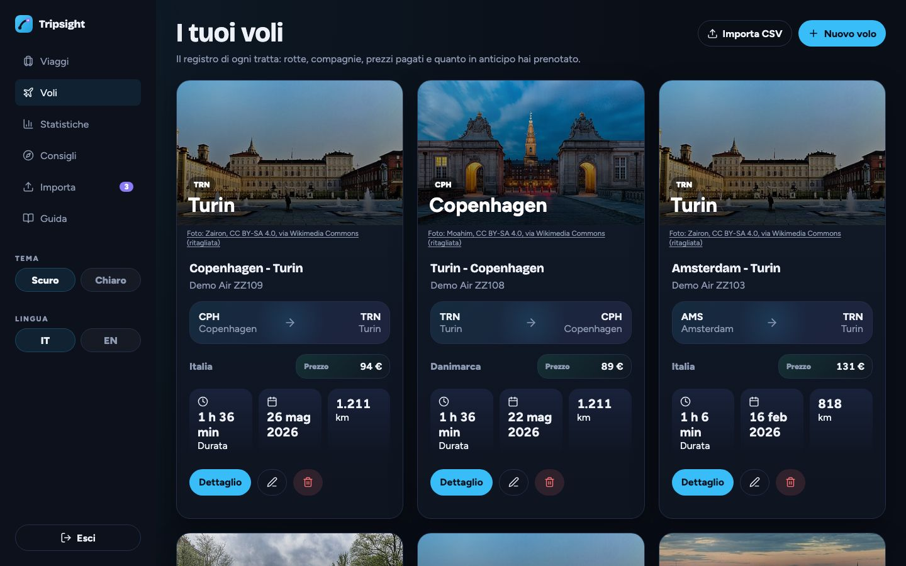
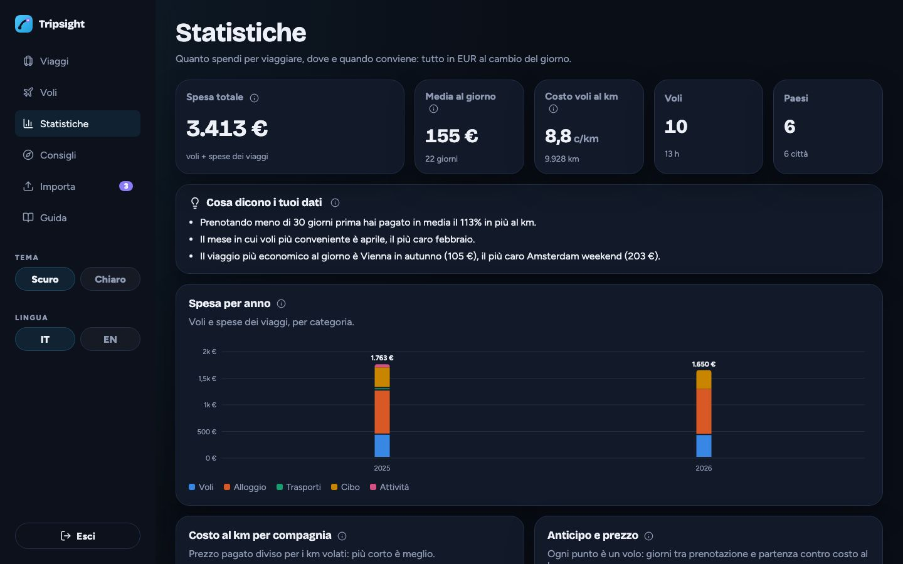
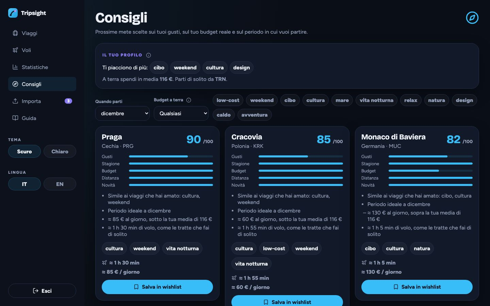
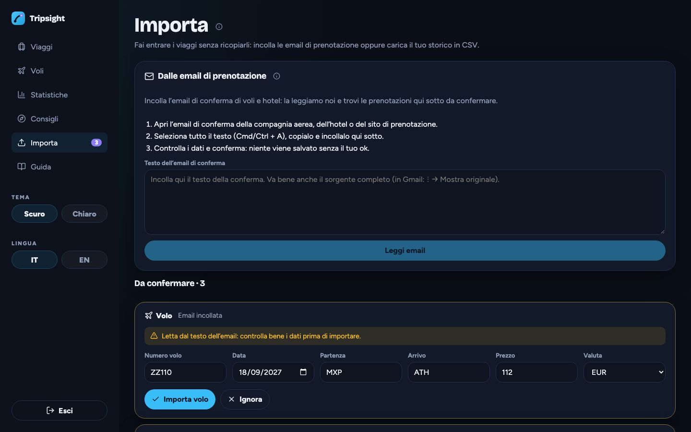

# Tripsight

Il diario di viaggio che ti dice **quanto spendi davvero per viaggiare, e dove andare dopo**.

Non è un live tracker dei voli: è un archivio personale che unisce voli, spese e ricordi di ogni viaggio, li trasforma in analisi di costo (al giorno, al km, per compagnia, per anticipo di prenotazione) e propone le prossime mete in base a gusti, budget reale e stagione.

> **Beta.** Gira in locale con dati fittizi, senza chiavi API. Lo stato completo è nella sezione [Stato del progetto](#stato-del-progetto-beta).

## Schermate

Tutte le schermate usano un account demo con dati fittizi (voli `ZZ`, prezzi inventati).


*I miei voli: ogni tratta con durata, distanza e prezzo; sotto ogni foto autore e licenza da Wikimedia Commons.*


*Statistiche: spesa totale e al giorno, costo al km e frasi di sintesi calcolate sui miei viaggi.*


*Consigli: mete con punteggio su 100 spiegato fattore per fattore (gusti, stagione, budget, distanza, novità).*


*Import da email: incollo una conferma e le prenotazioni trovate restano "da confermare", con i campi modificabili.*

<p>
  
  
</p>

*Su smartphone: navigazione in basso e schede a colonna singola (voli e consigli).*

## Stack

- **Frontend:** Vue 3 (Composition API), Vite, Vue Router, Pinia, Leaflet con mappe OpenStreetMap
- **Backend:** Node.js, Express, JWT, bcrypt
- **Persistenza:** file JSON locale (`server/src/data/travelcheck.json`) con scritture in coda e salvataggio atomico
- **Qualità:** ESLint su client e server, test con `node:test`, CI su GitHub Actions (lint, test, build)

## Requisiti

- Node.js 22 o successivo (la versione è in `.nvmrc`: con nvm basta `nvm use`)
- npm 10 o successivo

Non servono database, Docker né chiavi API: in sviluppo i dati dei voli e le tariffe arrivano da fornitori simulati.

## Avvio locale

```bash
nvm use                            # Node 22, da .nvmrc
npm install                        # installa client e server (npm workspaces)
cp server/.env.example server/.env
npm run dev
```

- Frontend: http://localhost:5173
- API: http://localhost:4000

Poi apro il frontend, creo un account (resta solo sul mio computer, in `server/src/data/travelcheck.json`) e inizio a inserire voli e viaggi.

Per provare il recupero dati da numero volo con i dati fittizi uso, per esempio:

| Numero volo | Cosa mostra |
|---|---|
| `ZZ100` | volo Torino → Barcellona |
| `ZZ206` | un numero volo con due tratte (JFK → MXP → DXB): l'app chiede quale ho fatto |
| `XX3642` | un codeshare venduto su due voli diversi |
| `ZZ9999` | volo inesistente: l'app passa all'inserimento manuale degli aeroporti |
| `ZZ9001` | quota del fornitore esaurita: messaggio chiaro invece di "volo non trovato" |

## Variabili d'ambiente

Il file `server/.env.example` funziona così com'è in sviluppo. Le variabili principali:

| Variabile | Predefinito | A cosa serve |
|---|---|---|
| `FLIGHT_PROVIDER` | `mock` | `mock` usa i voli fittizi; `airlabs` usa l'API AirLabs (serve `AIRLABS_API_KEY`) |
| `FARE_PROVIDER` | `mock` | `mock` genera tariffe sintetiche; `travelpayouts` usa la Data API di Travelpayouts (serve `TRAVELPAYOUTS_TOKEN`) |
| `RESEND_API_KEY` | vuoto | invio dell'email di recupero password; senza chiave, in sviluppo il link compare nel log del server |
| `JWT_SECRET` | vuoto | in sviluppo uso un segreto di sviluppo; in produzione il server non parte senza una stringa casuale di almeno 32 caratteri |

Con i fornitori reali le risposte restano in **cache su disco** (`server/src/data/cache/`, ignorata da git), condivisa tra tutti gli utenti: riprovare lo stesso volo o la stessa tratta non consuma richieste. Nel log del server ogni chiamata reale è segnata con `[voli]` o `[prezzi]`.

## Aeroporti

Il repository include un catalogo di base (`server/src/data/airports-base.csv`, circa 4.200 aeroporti con codice IATA e voli di linea), quindi l'app funziona subito. Per il catalogo completo:

```bash
npm run sync:airports --workspace server
```

Il file viene salvato in `server/src/data/airports.csv` (ignorato da git). Il server carica il catalogo all'avvio: dopo la sincronizzazione va **riavviato** (`npm run dev`).

I dati degli aeroporti vengono da [OurAirports](https://ourairports.com/data/) (pubblico dominio).

## Funzionalità

- **Viaggi:** raggruppano voli e spese (alloggio, trasporti, cibo, attività…), con costo totale e al giorno, voto, tag e "ci torneresti?"
- **Voli:** recupero dati da numero volo e data, oppure inserimento manuale degli aeroporti; se un numero volo copre più tratte scelgo quella giusta; biglietti A/R con totale condiviso; data di prenotazione
- **Tariffe di mercato:** nel form del volo vedo la tariffa minima e quella tipica (75° percentile) trovate per la tratta nel mese, con il confronto con quanto ho pagato io in passato
- **Valute:** ogni importo è convertito in EUR al cambio BCE della data ([Frankfurter](https://frankfurter.dev)); le statistiche non sommano mai valute diverse
- **Statistiche:** spesa per anno e categoria, costo al km per compagnia e per mese, anticipo di prenotazione rispetto al prezzo, classifica dei viaggi per costo al giorno, frasi di sintesi quando i dati bastano
- **Consigli:** 53 mete con punteggio spiegabile su 100 (gusti 35, stagione 20, budget 20, distanza 15, novità 10), filtri per mese, budget e tipo; wishlist salvata sul server
- **Import dalle email:** incollo il testo di una conferma di volo o hotel (va bene anche il sorgente completo `.eml`). L'app legge i dati strutturati schema.org quando ci sono, altrimenti l'itinerario nel testo, verificando i codici aeroporto sul catalogo; riconosce i biglietti A/R e la data di prenotazione. Tutto passa da una lista "Da confermare" con i campi modificabili
- **Import CSV:** export di Flighty o CSV generico (anche con `;` e date italiane), con anteprima riga per riga e deduplica
- **PWA:** installabile su mobile, con barra di navigazione in basso; nella build di produzione l'interfaccia resta disponibile offline
- **Account:** JWT, recupero password via link email, interfaccia in italiano e inglese, tema chiaro e scuro

## Privacy e conformità

- Informativa privacy pubblica su `/privacy`, in italiano e inglese. I dati del titolare si compilano in `client/src/config/legal.js`: finché mancano compaiono evidenziati come "da completare"
- Diritti GDPR in autonomia da Profilo → I tuoi dati: esportazione completa in JSON ed eliminazione definitiva dell'account
- Nessun cookie né tracciamento; font ospitati in locale e foto delle città scaricate dal server, così il browser non invia l'IP a terzi. Ogni foto mostra autore e licenza, con il link alla pagina del file su Wikimedia
- Le chiamate ai fornitori di voli e tariffe partono dal server e contengono solo numero volo, tratta e date, mai dati dell'utente
- Pulizia automatica dei dati email (30 giorni se gestiti, 90 se mai confermati) e limite ai tentativi di accesso
- Limite di richieste per account sugli endpoint più costosi: recupero volo (30 ogni 15 minuti), tariffe di mercato (60) e import email incollate (20). Oltre la soglia il server risponde `429` con l'intestazione `Retry-After`. Il conteggio è in memoria, adatto a una singola istanza
- Valutazione AI Act (l'app non usa sistemi di IA: solo regole e statistiche descrittive), registro dei trattamenti, fornitori e checklist pre-lancio in [`docs/compliance/README.md`](docs/compliance/README.md)

## Script

```bash
npm run dev      # client e server in sviluppo
npm run lint     # ESLint su client e server
npm test         # test del server (node:test)
npm run build    # build di produzione del client
```

Il workflow `.github/workflows/ci.yml` esegue installazione, lint, test e build a ogni push e pull request su `main`.

I dati fittizi dei voli si rigenerano con `node server/scripts/generate-mock-flights.js`.

## Stato del progetto (beta)

**Funziona:**

- registrazione, accesso e recupero password
- voli con inserimento manuale o recupero da numero volo (modalità simulata inclusa, con scelta della tratta e gestione dei codeshare)
- viaggi con spese in più valute convertite al cambio BCE
- statistiche di costo: al giorno, al km, per compagnia, per anticipo di prenotazione
- consigli sulle prossime mete con punteggio spiegato
- import da email incollate e da CSV
- tariffe di mercato per tratta
- esportazione e cancellazione dei dati (GDPR)
- interfaccia in italiano e inglese, tema chiaro e scuro, installabile come PWA

**Limiti noti:**

- il recupero per numero volo dipende da un fornitore esterno a quota limitata e non trova i voli stagionali né quelli fuori dall'orario attuale; per i voli passati gli orari vengono dall'orario attuale della compagnia
- le tariffe di mercato sono le più basse trovate, di sola andata e senza bagaglio: indicano l'ordine di grandezza, non quanto si paga davvero
- i dati sono salvati su un file JSON, adatto a una singola istanza

**In programma:**

- fornitore dati volo con storico dei voli passati
- database relazionale

## Come è stato sviluppato

Ho ideato e diretto io il progetto: requisiti, architettura, scelte di prodotto, revisione del codice e test sono a mio carico. Gran parte del codice è stata scritta con [Claude Code](https://claude.com/claude-code) (Anthropic) sotto la mia supervisione: ho definito i compiti, verificato i risultati nell'app e nei test e deciso cosa tenere, cosa correggere e cosa scartare.

Per il progetto ho preparato anche un kit grafico per i social, non incluso in questo repository.

## Attribuzioni

- **Aeroporti:** [OurAirports](https://ourairports.com/data/), pubblico dominio
- **Mappe:** © [OpenStreetMap](https://www.openstreetmap.org/copyright) contributors, mostrato sulla mappa
- **Foto delle città:** [Wikimedia Commons](https://commons.wikimedia.org) e Wikipedia; autore e licenza di ogni foto compaiono sotto l'immagine
- **Cambi valuta:** [Frankfurter](https://frankfurter.dev), dati della Banca centrale europea
- **Font:** Bricolage Grotesque e Figtree, SIL Open Font License (licenze in `client/public/fonts/`)

## Licenza

Codice pubblicato a scopo di portfolio. Tutti i diritti riservati: non è concesso il riuso senza autorizzazione.
